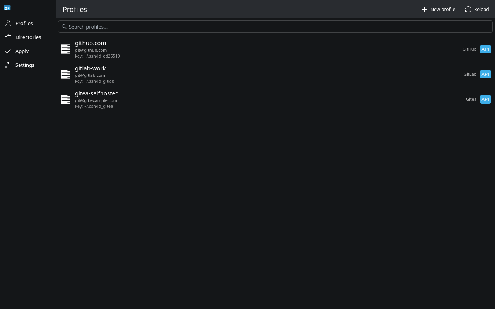
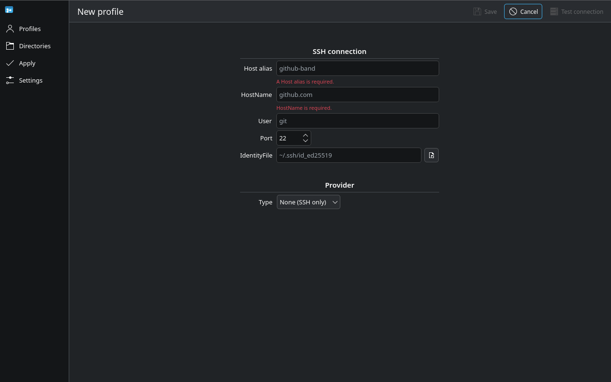
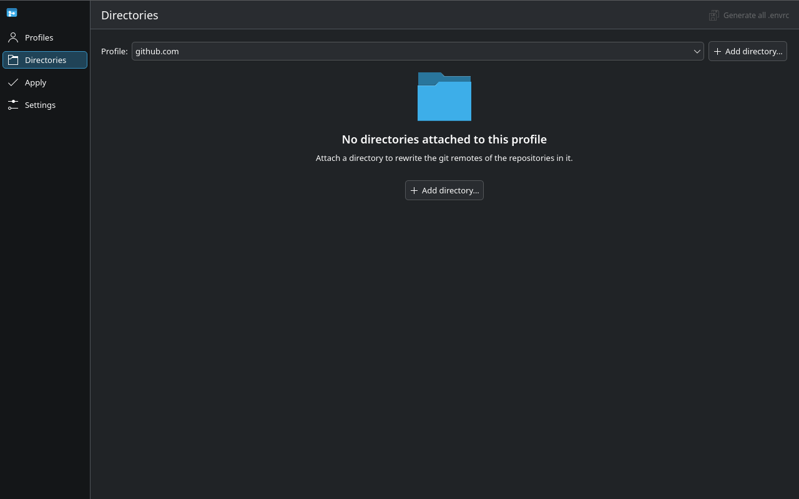

# Git Profiles

A Kirigami desktop app to organize your git repositories by SSH identity. It uses
`~/.ssh/config` as its database: each `Host` block is a profile. Attach a profile
to directories and it rewrites the `git remote` of every repository there to the
profile's identity (with a dry-run preview), and sets up the provider CLI
(`gh` / `gt` / `glab`) per directory via `direnv`, keeping tokens in the keyring.

Built with Qt6 + QML + Kirigami (KDE Frameworks 6).



|  |  |
| --- | --- |
|  |  |

## Install

### Fedora (RPM)

Download the latest `.rpm` from the [Releases page](https://github.com/hernique33comiitei/git-profiles/releases/latest)
and install it:

```sh
sudo dnf install ./git-profiles-*.x86_64.rpm
```

### Ubuntu / Debian (DEB)

Download the latest `.deb` from the [Releases page](https://github.com/hernique33comiitei/git-profiles/releases/latest)
and install it (apt pulls in the dependencies):

```sh
sudo apt install ./git-profiles_*_amd64.deb
```

### From source (Fedora)

For development, or to build the current `main`:

```sh
./install.sh
```

`install.sh` installs the build dependencies and `direnv` + `libsecret`, builds
the app with CMake/Ninja and installs it to `~/.local`. It only asks for `sudo`
the first time, to install missing packages, and adds the `direnv` shell hook to
`~/.bashrc`.

## Requirements

The app **never installs** git or the provider CLIs — it only checks for them and
points you to the download when you need one.

- **git** — required; the app shows only a notice until it is installed.
  <https://git-scm.com/downloads>
- **gh ≥ 2.104.0** — only for GitHub profiles
- **gt ≥ 1.2.0** — only for Gitea profiles
- **glab ≥ 1.130.0** — only for GitLab profiles

`direnv` (≥ 2.37.1) and `libsecret` are bundled as dependencies of the packages
(and installed by `install.sh`).

## How it works

- **`~/.ssh/config` is the single source of truth.** Each `Host` block is a
  profile. Extra metadata (provider, attached directories) lives in `#@gp`
  comment lines inside the block, which `ssh` ignores — so the file stays valid.
  Writes are backed up, atomic, and validated with `ssh -G`.
- **Attaching a profile to a directory** rewrites the `git remote` of the
  repositories there to the profile's host alias, editing `.git/config` directly
  (fast, parallel, idempotent) with a dry-run preview first. A directory can
  include the git repos one level below it.
- **Per-directory provider CLI** is configured through a `direnv` `.envrc`
  (`GH_CONFIG_DIR` / `GITLAB_TOKEN` / `GITEA_CLI_USER`), with tokens kept in the
  system keyring — never in plain files.

## License

MIT — see [LICENSE](LICENSE).
